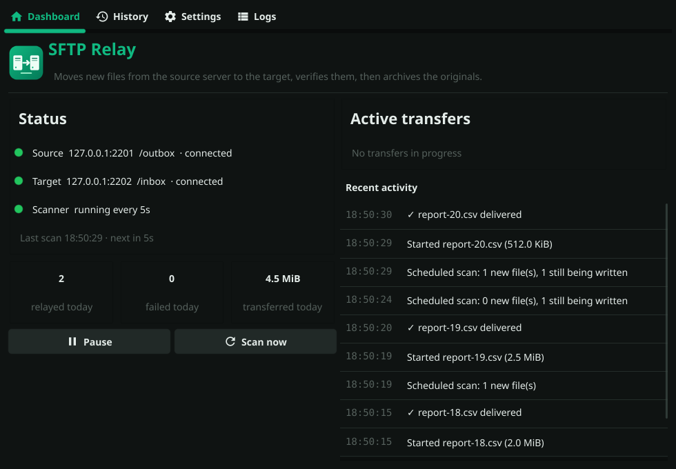
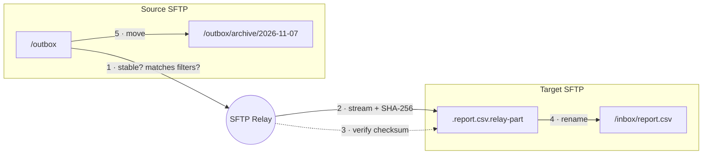

<p align="center">
  
</p>

<h1 align="center">SFTP Relay</h1>

<p align="center">
  Watches a folder on one SFTP server, delivers every new file to another server, verifies it, and archives the original — from a desktop app or as a headless service.
</p>

<p align="center">
  <a href="https://github.com/fabrianivan/sftp-relay/actions/workflows/ci.yml"></a>
  
  
</p>

<p align="center">
  
</p>

## Why

Many integrations still exchange files over SFTP: a partner drops reports into an outbox, and something has to pick them up, push them to another system, and keep a copy. SFTP Relay does exactly that, unattended, and is careful about the parts that usually go wrong — half-written files, flaky connections, and files that get archived but never actually delivered.

## Features

- **Relay + archive** — new files are copied from the source folder to the target folder, then moved into `<archive>/<YYYY-MM-DD>/` on the source (never overwriting: `name_1.csv`, `name_2.csv`, …).
- **Verified, atomic delivery** — uploads stream to a temporary name, are checked with SHA-256, then renamed into place (`posix-rename` when the server supports it), so readers on the target never see partial files.
- **Never loses a file** — a file is only archived after it has been delivered and verified. If the target is down, it stays in the source folder and is retried.
- **Waits for writers to finish** — a file is picked up only once its size and modification time stop changing.
- **Parallel transfers** with a configurable limit, include/exclude glob patterns, active-hours schedule (overnight windows supported).
- **Comprehensive audit logging** — every transfer, configuration change, and system event is logged with WHO, WHAT, WHEN, WHERE, and RESULT for compliance (SOC 2, ISO 27001, HIPAA). Includes UI viewer, query/export, and automatic log rotation.
- **Secure by default** — host keys are verified (trust-on-first-use with `known_hosts`, strict mode, or a pinned fingerprint); passwords live in the macOS Keychain / Windows Credential Manager / Secret Service instead of `config.json`; private-key login supported.
- **Desktop app** (Fyne) with live dashboard, progress bars, transfer history, **audit log viewer**, settings with *Test connection*, log viewer and a tray icon. Settings apply live — no restart.
- **Headless mode** for servers (`-headless`) and one-shot mode for cron/Task Scheduler (`-once`).

## How it works



1. Every poll interval the source folder is listed. Files that match the include/exclude patterns and have stopped changing are queued; each file is handled by one worker at a time.
2. The file is streamed to a hidden temporary file on the target while its SHA-256 is computed.
3. The upload is verified: size, checksum, and that the source did not change mid-upload (if it did, the file is retried later).
4. The temporary file is renamed to its final name, and the delivery is recorded in `history.json` — so if archiving fails, the next scan only archives and does not upload again.
5. The original is moved into the dated archive folder.

## Quick start

**Download** a build from [Releases](https://github.com/fabrianivan/sftp-relay/releases) (macOS `.app`, Windows `.exe`, Linux binary), or build from source with Go 1.24+:

```bash
git clone https://github.com/fabrianivan/sftp-relay.git && cd sftp-relay
go run .                      # desktop app
```

On first start a starter config is created and the Settings tab opens. Fill in both servers, press **Test connection** for each, then **Save & apply**.

**Try it without real servers:** `make demo` starts two throwaway in-memory SFTP servers on `localhost:2201`/`2202` (user `demo`, password `demo`) that keep dropping files, and opens the app pointed at them.

## Configuration

The config file is `./config.json` if it exists, otherwise the per-user config folder (`~/Library/Application Support/sftp-relay/config.json` on macOS, `%AppData%\sftp-relay\config.json` on Windows, `~/.config/sftp-relay/config.json` on Linux). Relative paths for logs, history and `known_hosts` are resolved next to it. See [`config.example.json`](config.example.json).

| Key | Default | Meaning |
|---|---|---|
| `sourceSFTP` / `targetSFTP` | — | `host`, `port` (22), `username`, `directory`, optional `privateKeyPath`, `expectedFingerprint`. Leave the target host empty for archive-only mode. |
| `backupDirectory` | — | Archive folder on the source server; files go into dated subfolders. |
| `pollInterval` | `30` | Seconds between scans (minimum 5). |
| `stableSeconds` | `10` | A file must be unchanged this long before it is picked up (`-1` disables). |
| `maxParallel` | `2` | Concurrent transfers (1–16). |
| `verifyChecksum` | `true` | Re-read the uploaded file and compare SHA-256. |
| `include` / `exclude` | `["*"]` / temp & hidden files | Case-insensitive glob patterns, e.g. `["*.csv", "*.xml"]`. |
| `reconnectRetries` / `reconnectInterval` | `3` / `5` | Retries per operation; backoff doubles from the interval, capped at 60 s. |
| `keepAliveDuration` | `30` | SSH keepalive interval in seconds. |
| `maxIdleScans` | `0` | Close idle sessions after N empty scans (`0` = keep open). |
| `strictHostKeyChecking` | `false` | Refuse unknown hosts instead of trusting on first use. |
| `activeSchedule` | off | `{enabled, start, end, timezone}` — e.g. `22:00`–`06:00` for nights only. Manual scans always run. |
| `logFile`, `logRetentionDays` | `logs/sftp-relay.log`, `14` | Daily-rotated logs. |
| `historyFile`, `historyLimit` | `history.json`, `1000` | Transfer journal shown in the History tab. |

Config files from **SFTP Watchdog** (this project's previous name) load as-is; legacy keys are migrated on the next save.

### Audit Logging

SFTP Relay includes comprehensive audit logging for compliance and security. Every file transfer, configuration change, and system event is logged with complete context (WHO, WHAT, WHEN, WHERE, RESULT).

Add to your `config.json`:

```json
{
  "auditLog": {
    "enabled": true,
    "logFile": "logs/audit.log",
    "retentionDays": 90,
    "logTransfers": true,
    "logConnections": true,
    "logConfigChanges": true
  }
}
```

**View audit logs:**
- In the GUI: click the **Audit** tab
- From terminal: `cat logs/audit.log | jq .`
- Programmatically: see [`docs/AUDIT_LOGGING.md`](docs/AUDIT_LOGGING.md)

**Features:**
- WHO, WHAT, WHEN, WHERE tracking with millisecond precision
- SHA-256 checksums for file integrity verification
- Filter by event type, status, time range, filename
- Export to JSON for analysis or compliance reports
- Automatic log rotation with optional gzip compression
- Secure: 0600 permissions, no passwords logged
- Compliance-ready: SOC 2, ISO 27001, HIPAA, PCI DSS

See the [Audit Logging Guide](docs/AUDIT_LOGGING.md) for complete details.

### Passwords and keys

Passwords are looked up in this order:

1. Environment variable `SFTP_RELAY_SOURCE_PASSWORD` / `SFTP_RELAY_TARGET_PASSWORD` (good for services and containers)
2. The system keychain — saved automatically from **Settings**, or from a terminal with `sftp-relay -set-password source`
3. A plaintext `password` in `config.json` (supported for compatibility; the app warns about it)

For key-based login set `privateKeyPath` (OpenSSH or PEM). An encrypted key's passphrase comes from `SFTP_RELAY_<ROLE>_KEY_PASSPHRASE` or the keychain.

### Host keys

Unless `expectedFingerprint` pins a key, the first key a server presents is recorded in `known_hosts`, and any later change is refused with a clear error — that is what protects you from a man-in-the-middle. With `strictHostKeyChecking`, unknown servers are refused until you confirm their fingerprint via **Test connection** (or `-check`).

## Running on a server

```bash
sftp-relay -config /etc/sftp-relay/config.json -check      # test both connections, print fingerprints
sftp-relay -config /etc/sftp-relay/config.json -headless   # run continuously, logs to stdout + file
sftp-relay -config /etc/sftp-relay/config.json -once       # one pass; exit 1 if any file failed (cron)
```

<details>
<summary>systemd unit</summary>

```ini
[Unit]
Description=SFTP Relay
After=network-online.target

[Service]
ExecStart=/usr/local/bin/sftp-relay -headless -config /etc/sftp-relay/config.json
EnvironmentFile=/etc/sftp-relay/secrets.env
User=sftp-relay
Restart=on-failure

[Install]
WantedBy=multi-user.target
```

`secrets.env` (mode 600) contains `SFTP_RELAY_SOURCE_PASSWORD=…` and `SFTP_RELAY_TARGET_PASSWORD=…`. On shutdown, running transfers get up to 60 s to finish; interrupted uploads leave the source untouched.
</details>

| Flag | |
|---|---|
| `-config path` | Config file location |
| `-headless` | Run without the GUI until SIGINT/SIGTERM |
| `-once` | Single pass (`-scan` still works for SFTP Watchdog scripts) |
| `-check` | Validate config and test connections |
| `-set-password source\|target` | Store a password in the system keychain |
| `-v` | Debug-level console output |
| `-version` | Print version |

## Development

```
main.go                  CLI flags, GUI / headless bootstrap
internal/relay           scan → deliver → verify → archive engine (+ stability tracker, events)
internal/sftpclient      reconnecting SFTP sessions, SSH auth, retry policy
internal/hostkey         known_hosts trust-on-first-use, pinning, strict mode
internal/secrets         macOS Keychain, Windows Credential Manager, Secret Service
internal/config          schema, defaults, validation, schedule, legacy migration
internal/history         persistent transfer journal
internal/logging         leveled, rotated logs with live subscribers
internal/setup           wiring shared by the GUI and CLI, connection tests
ui                       Fyne desktop app
tools/devserver          throwaway local SFTP servers for demos and manual testing
```

```bash
make test     # go test -race ./... — includes end-to-end tests over a real in-process SSH server
make lint
make build    # or scripts/build-macos.sh / scripts\build-windows.bat for packaged apps
```

Building the GUI needs CGO: Xcode command-line tools on macOS, a MinGW-w64 GCC on Windows, and `libgl1-mesa-dev xorg-dev` on Debian/Ubuntu. Tagging `vX.Y.Z` builds and publishes release binaries via GitHub Actions.

## Changes from SFTP Watchdog (v1)

The project was renamed from **SFTP Watchdog** when it was rebuilt in v2. Notable fixes:

- **Files could be archived without being delivered.** If the target was unreachable during a scan, v1 switched to "backup-only" mode for the rest of the session and archived every new file without uploading it. v2 keeps the file in the source folder and retries.
- **"Scan Now" could deadlock all future scans.** v1's lock helper left a goroutine waiting on the scan mutex that later acquired it and never released it. v2 uses `TryLock`.
- **Duplicate uploads.** Scheduled scans started uploads in the background and released the scan lock immediately, so the next scan could pick the same file again. v2 tracks in-flight files.
- **Half-written files were picked up.** v2 waits for size and mtime to settle and re-checks the source after copying.
- **Host keys were not verified** unless a fingerprint was pinned (`InsecureIgnoreHostKey`). v2 uses `known_hosts`.
- **Passwords were stored in plain text** in `config.json`. v2 uses the OS keychain or environment variables.
- Every scan read each source file completely just to hash it, and startup wrote test files into `/tmp` on production servers — both removed.
- The UI updated widgets from background goroutines (unsafe since Fyne 2.6), overnight schedules were rejected by validation, and sub-second transfers reported `0 B/s`.
